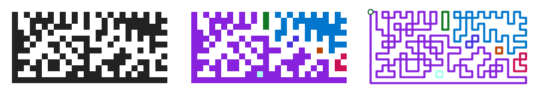

<a href="https://datalog.github.io/demo/datamatrix-svg/"></a>

# Data Matrix generator [](/LICENSE)

Data Matrix ECC 200 generator in pure JavaScript with compact SVG output and no dependencies. Supports square and classic rectangular symbols (ISO/IEC 16022:2024), plus DMRE (ISO/IEC 21471:2025).

The generator combines ASCII, C40, Text, ANSI X12, EDIFACT, and Base 256 encoding modes to reduce symbol size.

### [Data Matrix Generator](https://datalog.github.io/demo/datamatrix-svg/) (Live Demo)

Enter your text, adjust the settings, and inspect the decoded segments or SVG contours.

---

> [!NOTE]
> Download [datamatrix.min.js](datamatrix.min.js) for use in a browser or Node.js. The readable source, [datamatrix.js](datamatrix.js), provides the same API.

<br>

## Quick start

### In an HTML page

**SVG element** — include the generator and append the returned element to a container:

```html
<div id="datamatrix"></div>
<script src="datamatrix.min.js"></script>
<script>
    document.getElementById( 'datamatrix' )
        .appendChild( DATAMatrix( 'Hello World!' ) );
</script>
```

**SVG string** — alternatively, use `str: 1` to get SVG markup:

```javascript
var svgText = DATAMatrix( { msg: 'Hello World!', str: 1 } );

document.getElementById( 'datamatrix' ).innerHTML = svgText;
```

`DATAMatrix( text )` is shorthand for `DATAMatrix( { msg: text } )`. The same options apply to both SVG output modes.

### In Node.js

In Node.js, set `str: 1` to return SVG markup without a DOM library:

```javascript
var DATAMatrix = require( './datamatrix.min.js' );
var fs = require( 'fs' );

var svgText = DATAMatrix( { msg: 'Hello World!', str: 1 } );

fs.writeFileSync( 'datamatrix.svg', svgText );
```

## Options

```javascript
var svgNode = DATAMatrix( {

     msg :  'Hello World!'
    ,dim :   256
    ,pad :   2
    ,rct :   0
    ,ver :  ''
    ,esc :   0
    ,pal : ['#000', '#f2f4f8']
    ,vrb :   0
    ,str :   0

} );
```

| Option | Default | Description |
| :--- | :--- | :--- |
| `msg` | `''` | Unicode text to encode. Non-ASCII text uses UTF-8 with ECI 26. |
| `dim` | `256` | SVG height in pixels. The width scales automatically. Both include the quiet zone. |
| `pad` | `2` | Quiet zone on each side, measured in modules. Set to `0` to omit it. |
| `rct` | `0` | `0`: square; `1`: prefer a classic rectangle; `2`: also allow DMRE rectangles. Falls back to a square when no allowed rectangle fits. |
| `ver` | `''` | Fix the height × width, for example `'20x36'` for DMRE. Overrides `rct`. Leave empty for automatic selection. |
| `esc` | `0` | Set to `1` to recognize escapes, FNC1, GS separators, and complete Macro 05/06 wrappers. See [Escapes and commands](#escapes-and-commands). |
| `pal` | `['#000']` | Foreground and optional background as `#RGB` or `#RRGGBB`. The background is transparent when omitted. |
| `vrb` | `0` | Set to `1` to describe each dark module separately in the SVG path. The encoded matrix stays the same. |
| `str` | `0` | Set to `1` to return SVG markup as a string. The default returns an SVG DOM element. |

A fixed size throws a `RangeError` if the size is unknown or the message does not fit.

## Text encoding

The generator converts the input string to UTF-8 and chooses encoding modes for the resulting bytes. It adds ECI 000026 if the text contains non-ASCII characters.

<details>
<summary>UTF-8, ECI, and segment boundaries</summary><br/>

ECI specifies how decoded bytes are interpreted. Under [ISO/IEC 16022:2024](https://www.iso.org/standard/80926.html), 7.3.2–7.3.3, it remains active across packing-mode changes until another ECI is invoked or the data ends.

When needed, the generator writes the UTF-8 ECI codewords `241,27` after any GS1 or Macro prefix and includes their cost when selecting the symbol size. ASCII letters and digits retain their one-byte UTF-8 representation and can use compact packing modes within a Unicode message.

Without ECI, the standard's default interpretation is ISO-8859-1 (ECI 000003), as specified in 7.2.2.

</details>

## Escapes and commands

Set `esc: 1` to process escapes and commands, or turn on **Recognize escapes and commands** in the demo. With `esc: 0`, these sequences are treated as literal text.

| Input | Meaning with `esc: 1` |
| :--- | :--- |
| `\xXX` | A character with the two-digit hexadecimal value. It is then encoded in UTF-8: `\xE8` means `è`, not a raw byte `E8`. |
| `\\` | One literal backslash. Escape replacement is not recursive. |
| `<FNC1>` | An explicit FNC1 command. At the start, without a Macro header, it selects GS1. |
| `<GS>` or a GS character (`\x1D`) | A field separator: FNC1 in a GS1 message, otherwise the ordinary GS character. |
| `[)>\x1E05\x1D…\x1E\x04` | A complete Macro 05 wrapper. |
| `[)>\x1E06\x1D…\x1E\x04` | A complete Macro 06 wrapper. |

Command tags are case-insensitive. Escapes are expanded before commands are recognized, so `\x3CFNC1>` also becomes an FNC1 command. Unknown or incomplete escapes remain unchanged.

```javascript
DATAMatrix( {

     msg : '<FNC1>010123456789012810ABC\\x1D211234'
    ,esc : 1

} );
```

The doubled backslash in the JavaScript example passes the literal escape `\x1D` to the generator. An actual GS character in the input works too.

<details>
<summary>GS1, FNC1, and Macro 05/06</summary><br/>

FNC1 in the second codeword position can identify an industry application when it follows a letter or a digit pair.

Macro 05/06 replaces a complete standard header and trailer with one codeword, `236` or `237` ([ISO/IEC 16022:2024](https://www.iso.org/standard/80926.html), 7.2.4.8 / Table 3). The wrapper must cover the whole message. Trailing whitespace after the wrapper is ignored. A Macro header takes precedence over GS1 detection. GS separators in the body remain ordinary character 29, while explicit `<FNC1>` commands retain their meaning. The demo reader restores the full Macro header and trailer.

The generator does not support general ECI switching, Structured Append, or Reader Programming.

</details>

## Symbol sizes and capacity

The generator supports 24 square ECC 200 sizes from 10 × 10 to 144 × 144 modules, six classic rectangles, and 18 DMRE formats.

For automatic selection, `rct: 1` considers classic rectangles and `rct: 2` also considers DMRE. The generator picks the smallest fitting rectangular area, preferring the lower height when areas are equal. If no rectangle fits, it tries a square.

Use `ver` to fix the size. This example selects a DMRE symbol 20 modules high and 36 modules wide.

```javascript
DATAMatrix( { msg: 'Hello!', ver: '20x36' } );
```

Symbol sizes are written as rows × columns (height × width), as specified in ISO/IEC 16022:2024, §6.3.3, and ISO/IEC 21471:2025, Table 1. The tables below and the demo's **Symbol size** menu and **Matrix** field use this order. Use a lowercase `x` in `ver`.

<details>
<summary>Symbol sizes and data capacities</summary><br/>

Dimensions include the finder borders and exclude the quiet zone. Each codeword is eight bits; data capacity includes mode switches, service commands, and padding.

| Square size | Data codewords | Square size | Data codewords |
| :--- | ---: | :--- | ---: |
| 10 × 10 | 3 | 44 × 44 | 144 |
| 12 × 12 | 5 | 48 × 48 | 174 |
| 14 × 14 | 8 | 52 × 52 | 204 |
| 16 × 16 | 12 | 64 × 64 | 280 |
| 18 × 18 | 18 | 72 × 72 | 368 |
| 20 × 20 | 22 | 80 × 80 | 456 |
| 22 × 22 | 30 | 88 × 88 | 576 |
| 24 × 24 | 36 | 96 × 96 | 696 |
| 26 × 26 | 44 | 104 × 104 | 816 |
| 32 × 32 | 62 | 120 × 120 | 1050 |
| 36 × 36 | 86 | 132 × 132 | 1304 |
| 40 × 40 | 114 | 144 × 144 | 1558 |

| Rectangular size (height × width) | Data codewords |
| :--- | ---: |
| 8 × 18 | 5 |
| 8 × 32 | 10 |
| 12 × 26 | 16 |
| 12 × 36 | 22 |
| 16 × 36 | 32 |
| 16 × 48 | 49 |

DMRE formats from [ISO/IEC 21471:2025](https://www.iso.org/standard/84783.html), Table 1:

| DMRE size (height × width) | Data codewords |
| :--- | ---: |
| 8 × 48 | 18 |
| 8 × 64 | 24 |
| 8 × 80 | 32 |
| 8 × 96 | 38 |
| 8 × 120 | 49 |
| 8 × 144 | 63 |
| 12 × 64 | 43 |
| 12 × 88 | 64 |
| 16 × 64 | 62 |
| 20 × 36 | 44 |
| 20 × 44 | 56 |
| 20 × 64 | 84 |
| 22 × 48 | 72 |
| 24 × 48 | 80 |
| 24 × 64 | 108 |
| 26 × 40 | 70 |
| 26 × 48 | 90 |
| 26 × 64 | 118 |

DMRE symbols require a reader with DMRE support.

The number of characters that fit depends on the selected modes and service commands. The largest symbol holds up to 3,116 digits without additional headers.

</details>

## SVG contours

By default, one SVG path follows the outlines of the dark regions. Shared edges are removed, straight lines are combined, and holes stay open. This produces more compact SVG without changing the encoded matrix.

Turn on **Explore SVG contours** in the demo to see the outlines, or set `vrb: 1` to draw a separate square for each dark module.

For `Find joy in creating!`, shown above, both settings produce a 12 × 26 rectangular symbol (`rct: 1`):

| SVG output | Foreground path size |
| :--- | ---: |
| Separate squares (`vrb: 1`) | 2,181 bytes |
| Contours (default) | 651 bytes |
| Reduction | **70.2%** |

These are the sizes of the foreground path data (`d`), before compression. The saving depends on the message.

<details>
<summary>How contourPath builds the SVG</summary><br/>

For every dark module, `contourPath` keeps only sides bordering a light module or the outside of the matrix. Each edge is directed with the dark area on its right. A stack joins the edges into closed routes; outer boundaries and enclosed light areas wind in opposite directions, leaving the holes open.

Only turns need to be kept. Straight runs become `h` or `v` commands, and `z` closes each route.

</details>

## Compatibility and verification

The local demo reads the generated SVG modules, reconstructs the codewords, and checks finder borders, Reed–Solomon blocks, and payload bytes. The reader reports inconsistencies in the generated symbol and performs no error correction.

<details>
<summary>144 × 144 ECC interleaving</summary><br/>

The generator uses the ECC block order clarified in [ISO/IEC 16022:2024](https://www.iso.org/standard/80926.html), Annex A.1 and Figure A.2. For 144 × 144, eight blocks contain 156 data codewords each and two contain 155; every block has 62 ECC codewords. ECC starts with block 1, giving zero-based order `0,1,2,3,4,5,6,7,8,9`.

An older convention uses ECC block order `8,9,0,1,2,3,4,5,6,7`.

In local checks, ZXing Java 3.5.3 rejected three ISO-order 144 × 144 symbols with `ChecksumException` and decoded them when only the ECC order was rotated. A 132 × 132 control decoded in either case. This identifies a decoder compatibility difference, not an error in the generator's ISO ordering.

The generator uses the ISO order and does not expose a compatibility switch. If a reader rejects a 144 × 144 symbol, check which order it expects.

</details>

<details>
<summary>Reader coverage and conformance checks</summary><br/>

Round-trip checks with the demo reader and other libraries cover behavior and compatibility. Full conformance requires additional checks.

The demo reader supports the generator's ECC 200 and DMRE sizes, leading UTF-8 ECI, FNC1, and Macro 05/06. It returns decoded `text`, payload `bytes`, and an optional `utf8Text` view. Text follows the declared ECI or the ISO default. A displayed segment that splits a UTF-8 character shows its bytes rather than guessed characters.

Remaining checks cover all termination and shift cases, rejection of malformed streams, padding validation, and placement and ECC test vectors for every size. The demo reader does not support general ECI switching, Structured Append, or Reader Programming.

</details>

<br><br><br>

## Credits and license

* Data Matrix is specified in [ISO/IEC 16022:2024](https://www.iso.org/standard/80926.html); DMRE in [ISO/IEC 21471:2025](https://www.iso.org/standard/84783.html).
* Copyright © 2020–2026 Constantine. Released under the [MIT License](LICENSE).
